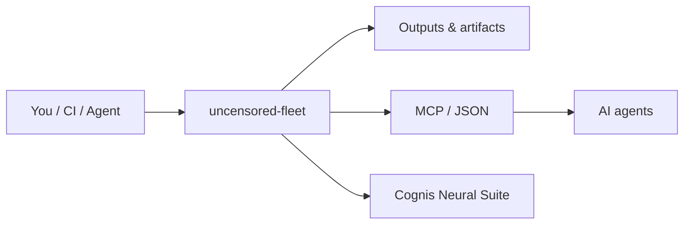

<a name="top"></a>
<div align="center">


# uncensored-fleet

### Deploy a local multi-model LLM fleet in one command — llama.cpp slots, an agent harness, and [engram](https://github.com/cognis-digital/engram) memory.

[](LICENSE)   [](https://github.com/cognis-digital/cognis-neural-suite)

*Your hardware. Your models. No API keys, no rate limits, nothing leaves the box.*

</div>

```bash
pip install cognis-uncensored-fleet
bash scripts/build-llamacpp.sh     # build the engine (CUDA/Metal/Vulkan auto)
fleet pull all                     # download the model fleet
fleet up uncensored                # start the commander slot
fleet agent "summarize ./notes and propose next steps"
```


<!-- cognis:example:start -->
## 🔎 Example output

Real, reproducible output from the tool — runs offline:

```console
$ uncensored-fleet-emit --version
uncensored-fleet 0.3.0
```

```console
$ fleet --help
usage: fleet [-h] [--version]
             {models,pull,up,down,status,setup,doctor,run,agent} ...

uncensored-fleet — local multi-model LLM fleet + harness (engram-integrated)

positional arguments:
  {models,pull,up,down,status,setup,doctor,run,agent}
    models              list fleet slots
    pull                download a slot's model (or 'all')
    up                  start a slot (or 'all')
    down                stop a slot (or all)
    status              show fleet status
    setup               install llama.cpp + pull all models
    doctor              diagnose the local environment
    run                 one-shot prompt to a slot
    agent               run the agent harness on a task

options:
  -h, --help            show this help message and exit
  --version             show program's version number and exit
```

```console
$ fleet doctor
uncensored-fleet 0.3.0 — environment check
models dir: ~/.cognis-fleet/models

  [ok  ] python         3.12.4 (need >= 3.10)
  [warn] llama-server   'llama-server' not on PATH — run scripts/build-llamacpp.sh
  [ok  ] disk           220.6 GB free at ~/.cognis-fleet/models (recommend >= 40 GB)
  [warn] slots          0/5 downloaded (none); live: none

healthy
```

```console
$ uncensored-fleet-emit status
reasoning    :8771  down  planning, analysis, chain-of-thought
  math         :8772  down  math, SymPy-verifiable problems
  coding       :8773  down  code generation + edits
  vision       :8775  down  image understanding / OCR
  uncensored   :8774  UP    lead/commander, unrestricted local reasoning
```

> Blocks above are real `uncensored-fleet` output — reproduce them from a clone.

<!-- cognis:example:end -->

## Usage — step by step

1. **Install** the `fleet` command, then build llama.cpp + pull models (`setup` prints the platform script to run first):
   ```bash
   pip install -e .
   fleet setup
   ```
2. **List the slots** to see each model, its port, VRAM and role:
   ```bash
   fleet models
   ```
3. **Pull and start** a slot (use `all` for the whole fleet), then check it's serving:
   ```bash
   fleet pull all
   fleet up uncensored
   fleet status
   ```
4. **Use the fleet** — send a one-shot prompt to a slot, or run the agent harness on a task (`--slot` defaults to `uncensored`):
   ```bash
   fleet run uncensored "summarize this repo"
   fleet agent "scaffold a fizzbuzz module with tests" --slot coding
   ```
5. **Tear down** when finished (omit the slot to stop all):
   ```bash
   fleet down
   ```

## Contents
- [Why](#why) · [The fleet](#the-fleet) · [Quick start](#quick-start) · [The harness](#the-harness) · [Engram memory](#engram-memory) · [Diagnose](#diagnose) · [Configuration](#configuration) · [JSON output](#json-output) · [FAQ](#faq) · [Explore the suite](#explore-the-suite)

**Deep docs:** [docs/ARCHITECTURE.md](docs/ARCHITECTURE.md) · [docs/USAGE.md](docs/USAGE.md) · [ROADMAP.md](ROADMAP.md) · [docs/INSTALL.md](docs/INSTALL.md)

<a name="why"></a>
## Why

Cloud LLMs gate you on price, rate limits, and content policy. `uncensored-fleet` stands up a **fleet of
local models** — reasoning, math, coding, vision, and an **abliterated "commander"** — each served by
llama.cpp on your own GPU, and gives you a **model-agnostic agent harness** to drive them. It is the
deployment layer for a private, unrestricted, self-improving local AI stack.

<div align="right"><a href="#top">↑ back to top</a></div>

<a name="the-fleet"></a>
## The fleet

| Slot | Role | Default model | Port |
|---|---|---|---|
| `reasoning` | planning / analysis | DeepSeek-R1-Distill-Qwen-7B | 8771 |
| `math` | SymPy-verifiable problems | Qwen2.5-Math-7B | 8772 |
| `coding` | code gen + edits | Qwen2.5-Coder-7B | 8773 |
| `vision` | image / OCR | Qwen2-VL-7B | 8775 |
| `uncensored` | **commander**, unrestricted | Josiefied-Qwen3-8B-abliterated | 8774 |

VRAM-aware: conflicting slots auto-evict. Override any slot in `fleet.yaml`.

<a name="quick-start"></a>
## Quick start

```bash
fleet models                 # list slots
fleet pull all               # download GGUFs (huggingface_hub / hf-cli / direct)
fleet up all                 # start servers (or: fleet up coding)
fleet status                 # see what's live
fleet run coding "write a python LRU cache"
fleet agent "audit ./repo for secrets and write FINDINGS.md" --slot uncensored
fleet down                   # stop everything
```

<a name="the-harness"></a>
## The harness

A tiny, dependency-free agent loop (`fleet/harness.py`) talks to any slot over the llama.cpp
OpenAI-compatible endpoint and supports safe tools (`run_bash`, `read_file`, `write_file`) via a simple
`TOOL::` / `FINAL::` text protocol — model-agnostic, so it works with whatever you load.

<a name="engram-memory"></a>
## Engram memory

The harness remembers. It uses the Cognis **[engram](https://github.com/cognis-digital/engram)** fork for
portable, model-agnostic long-term memory when installed (`pip install "cognis-uncensored-fleet[engram]"`),
and falls back to a local SQLite store otherwise. Every task's outcome is recalled on the next related run.

<a name="diagnose"></a>
## Diagnose your box

Before you pull gigabytes of GGUFs, run the built-in health check. `fleet doctor` is read-only —
it never starts or stops a process — and inspects the things that commonly block a first run:

```bash
fleet doctor           # human-readable table; exit 0 when healthy
fleet doctor --json     # machine-readable report for CI / scripts
```

It reports your Python version, whether the `llama-server` binary is on `PATH`, free disk on the
models volume, and which slots are already downloaded or currently serving. Missing binary, low
disk, and "no models yet" are **advisories** (they never fail the check on a fresh machine); only a
too-old interpreter is a hard failure.

<a name="configuration"></a>
## Configuration (`fleet.yaml`)

Every slot in [`fleet/models.py`](fleet/models.py) can be overridden from a `fleet.yaml` in the
working directory (or point `$FLEET_CONFIG` elsewhere). Overrides are **merged** over the defaults,
so you only specify what changes — a new `repo`/`file` to swap a model, a different `port`, a
larger `ctx`, etc. Every subcommand (`models`, `pull`, `up`, `status`, `run`, `agent`, `doctor`)
honors it:

```yaml
# fleet.yaml — merged over fleet/models.py defaults
slots:
  uncensored:
    repo: your-org/your-abliterated-gguf
    file: model-Q5_K_M.gguf
    port: 8774
    ctx: 32768
  coding:
    port: 8801
```

```bash
$ fleet models          # ports/repos reflect fleet.yaml
  coding       :8801  7GB  bartowski/Qwen2.5-Coder-7B-Instruct-GGUF  — code generation + edits
```

PyYAML is used when present; otherwise a small built-in parser handles this documented subset with
**no extra dependency**.

Other environment knobs:

| Variable | Default | Purpose |
|---|---|---|
| `FLEET_CONFIG` | `fleet.yaml` | path to the override file |
| `FLEET_MODELS_DIR` | `~/.cognis-fleet/models` | where GGUFs are stored |
| `FLEET_STATE` | `~/.cognis-fleet/state.json` | running-process state |
| `FLEET_MEMORY` | `~/.cognis-fleet/memory.sqlite` | fallback memory store |
| `LLAMA_SERVER` | `llama-server` | llama.cpp server binary / path |

<a name="json-output"></a>
## JSON output

`models` and `status` speak JSON for pipelines and dashboards:

```bash
fleet models --json | jq '.coding.port'          # -> 8773
fleet status --json | jq '.[] | select(.state=="UP") | .slot'
```

<a name="explore-the-suite"></a>
## Explore the Cognis Neural Suite

`uncensored-fleet` is the local-AI backbone of the **[Cognis Neural Suite](https://github.com/cognis-digital/cognis-neural-suite)** (170+ tools). Pair it with:

- 🧠 **[engram](https://github.com/cognis-digital/engram)** — model-agnostic agent memory
- 🛠️ **[skills](https://github.com/cognis-digital/skills)** — agent skill registry the harness can load
- 🤖 **[agentsmith](https://github.com/cognis-digital/agentsmith)** · **[evalbench](https://github.com/cognis-digital/evalbench)** · **[modelroute](https://github.com/cognis-digital/modelroute)** — orchestrate, evaluate, route
- 📚 **[awesome-cognis](https://github.com/cognis-digital/awesome-cognis)** · **[cognis-sources](https://github.com/cognis-digital/cognis-sources)** — the full index

<a name="faq"></a>
## FAQ

**Do I need a GPU?** No — `uncensored-fleet` itself is standard-library Python and runs anywhere. The
*models* run under llama.cpp, which uses your GPU when built with CUDA/Metal/Vulkan and falls back to
CPU otherwise. `fleet doctor` tells you what your box is missing.

**Does anything leave my machine?** No. Servers bind to `127.0.0.1`, models are local GGUFs, and the
harness talks to `http://127.0.0.1:<port>/v1`. The only outbound traffic is the one-time model
download from Hugging Face.

**How do I swap in my own model?** Add a `slots:` block to `fleet.yaml` overriding the `repo`/`file`
(and optionally `port`/`ctx`) — see [Configuration](#configuration). No code change required.

**Why do `reasoning` and `uncensored` evict each other?** They are marked as VRAM conflicts
(`SLOT_CONFLICTS`), so starting one stops the other to avoid OOM on a single GPU. Override the ports
and run them side by side if you have the memory.

**The harness returned "(max steps reached)".** The model kept emitting `TOOL::` calls without a
`FINAL::`. Raise `max_steps`, or use a stronger slot (e.g. `--slot reasoning`) for multi-step tasks.

**Is `fleet.yaml` required?** No. Without it, the built-in defaults apply and everything works
exactly as before.

## Responsible use
Local, unrestricted models are powerful. Use them lawfully and ethically; you are responsible for what you generate and run.

## How it fits



**Explore the suite →** [🗂️ all tools](https://github.com/cognis-digital/cognis-neural-suite) · [⭐ awesome-cognis](https://github.com/cognis-digital/awesome-cognis) · [🔗 cognis-sources](https://github.com/cognis-digital/cognis-sources)

## Interoperability

`uncensored-fleet` composes with the 300+ tool Cognis suite — JSON in/out and a shared
OpenAI-compatible `/v1` backbone. See **[INTEROP.md](INTEROP.md)** for the
suite map, composition patterns, and reference stacks.

## Integrations

Forward `uncensored-fleet`'s findings to STIX/MISP/Sigma/Splunk/Elastic/Slack/webhooks via
[`cognis-connect`](https://github.com/cognis-digital/cognis-connect). See **[INTEGRATIONS.md](INTEGRATIONS.md)**.

## License
Source-available under the **Cognis Open Collaboration License (COCL) v1.0** — see [LICENSE](LICENSE). Commercial use: licensing@cognis.digital.

---
<div align="center"><sub><b><a href="https://cognis.digital">Cognis Digital</a></b> · part of the <a href="https://github.com/cognis-digital/cognis-neural-suite">Cognis Neural Suite</a> · <i>Making Tomorrow Better Today</i></sub></div>
